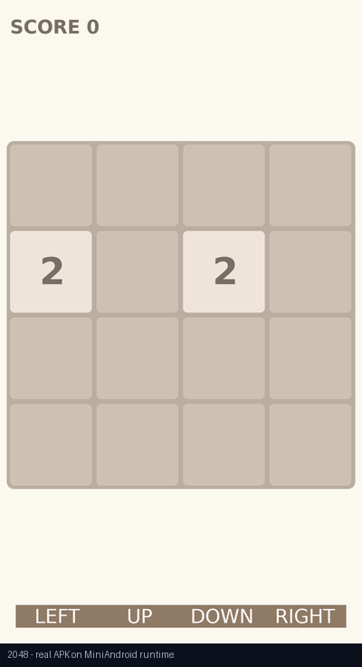
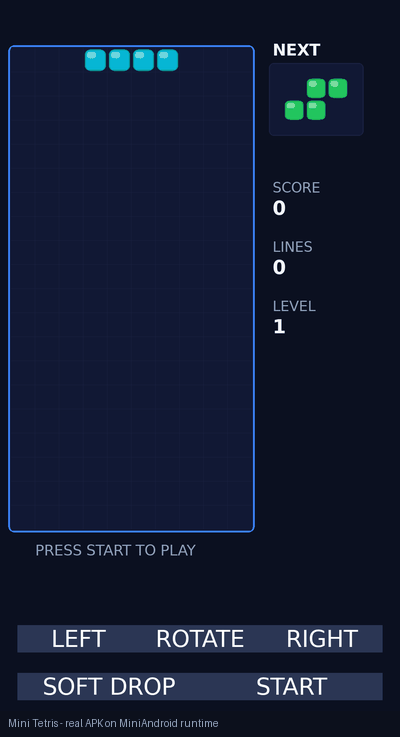
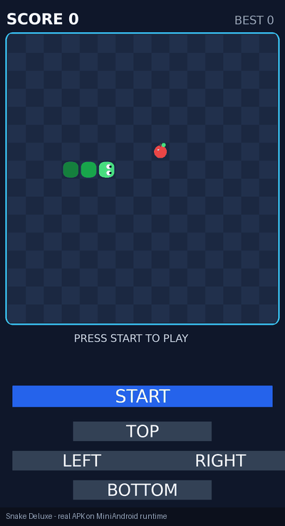
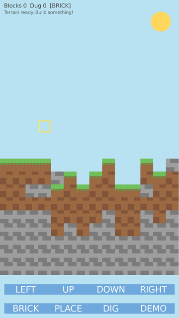

# MiniAndroid Compatibility Runtime

**A CPU-first Android APK compatibility runtime for x86/x86_64 Linux.** MiniAndroid parses real APKs, executes Dalvik bytecode in its own engine, and renders application UI without an Android emulator, virtual machine, or ARM translation layer.

[](https://sh-tb.github.io/MiniAndroid-Compatibility-Runtime/)
[](https://github.com/Sh-TB/MiniAndroid-Compatibility-Runtime)
[](LICENSE)

> **Evidence-first project:** a successful launch, a meaningful rendered screen, and working interaction are three different claims. MiniAndroid records them separately. Historical evidence is never silently presented as a current reproduction.

---

## At a glance

- **Host:** Linux x86 / x86_64, CPU-first.
- **APK support:** pure-DEX APKs and APKs containing x86/x86_64 native libraries.
- **Execution:** a custom Dalvik-class bytecode engine and Android compatibility/shadow layer.
- **UI:** lifecycle, View layout/render traversal, input dispatch, a growing Compose subset, and a PortableGL GLES bridge.
- **Not an emulator:** no full Android OS, no VM, and no ARM binary translation.

For current project counts and status definitions, see [generated metrics](docs/METRICS.json) and the [canonical evidence registry](docs/evidence/canonical/registry.json). Counts are deliberately not duplicated here because the registry is the source of truth.

## Live achievement showcase

**[Open the MiniAndroid Showcase →](https://sh-tb.github.io/MiniAndroid-Compatibility-Runtime/)**

The separate GitHub Pages site is a lightweight public gallery. It displays genuine runtime captures and links each entry to its evidence record. The gallery is not part of the engine source tree; adding a verified achievement should update its data manifest and media references, not add bulky screenshots to C++ source directories.

---

## Canonical gameplay demonstrations

These are genuine animated gameplay captures from the project's canonical evidence archive — not mockups or promotional recreations.

<table>
  <tr>
    <td width="50%" align="center">
      <a href="docs/evidence/canonical/com.miniandroid.g2048.gif"></a><br>
      <strong>2048</strong><br>
      Tile movement, merges, and score/state progression<br>
      <sub><a href="docs/evidence/canonical/registry.json">Canonical record 52</a> · <a href="https://github.com/Sh-TB/MiniAndroid-Compatibility-Runtime/blob/main/docs/evidence/canonical/registry.json">Evidence registry</a></sub>
    </td>
    <td width="50%" align="center">
      <a href="docs/evidence/canonical/com.miniandroid.tetris.gif"></a><br>
      <strong>Mini Tetris</strong><br>
      Falling pieces, next queue, and timed animation<br>
      <sub><a href="docs/evidence/canonical/registry.json">Canonical record 51</a> · Current fresh check: visually partial</sub>
    </td>
  </tr>
  <tr>
    <td width="50%" align="center">
      <a href="docs/evidence/canonical/com.miniandroid.snakedeluxe.gif"></a><br>
      <strong>Snake Deluxe</strong><br>
      Snake movement, food collection, and state transitions<br>
      <sub><a href="docs/evidence/canonical/registry.json">Canonical record 50</a></sub>
    </td>
    <td width="50%" align="center">
      <a href="docs/evidence/canonical/com.miniandroid.minicraft.gif"></a><br>
      <strong>MiniCraft — House Builder</strong><br>
      Terrain traversal, block placement, digging, and house building<br>
      <sub><a href="docs/evidence/canonical/registry.json">Canonical record 147</a></sub>
    </td>
  </tr>
</table>

**How to read these demonstrations:** the GIFs prove that the captured gameplay sequence was rendered. They do not, by themselves, prove that the same result reproduces on today's engine HEAD. The registry records the campaign provenance and the latest known status; the Showcase keeps historical and current status distinct.

---

## Selected execution evidence

The following examples were recorded on release-candidate binary `06f98d2a9c21ea92` during the **2026-11-13 S230 campaign**. They are valuable historical execution records, not a blanket claim that every result has been re-run on the current repository HEAD.

| Application | Demonstrated result | Direct execution evidence |
|---|---|---|
| **Vector Pinball (Bouncy)** | GL surface composited with the app menu and status bar; face `98abca38`, zero uncaught exceptions in the recorded run | [Run report](evidence/s207/runs/s207_gold_bouncy/report.md) · [Gameplay GIF](docs/evidence/canonical/com.dozingcatsoftware.bouncy.gif) |
| **GameMasterDice** | Real dice-roll taps; two independent recorded runs produced identical face hash `3891679d` | [Run 1](evidence/s207/runs/s207_gmdice_r1/report.md) · [Run 2](evidence/s207/runs/s207_gmdice_r2/report.md) |
| **TicTacToe Deluxe** | Game loop, win/stalemate board states, and three deterministic recorded runs (`7354c1b2`) | [Run evidence](evidence/s207/runs/s207_ttt0/report.md) · [Gameplay GIF](docs/evidence/canonical/com.emmanuelmess.tictactoe.gif) |
| **uNote** | Notes application UI; recorded face hash `3b8dcb0a` | [Run report](evidence/s207/runs/s207_gold_unote/report.md) · [Screenshot](docs/evidence/canonical/app.varlorg.unote.jpg) |
| **MicroTimer** | Timer UI and tap path; recorded face hash `b39665f6`, zero uncaught exceptions | [Run report](evidence/s207/runs/s207_mtm_spot/report.md) · [Screenshot](docs/evidence/canonical/dubrowgn.microtimer.jpg) |

The original S207 gate is [`scripts/s207_gate.py`](scripts/s207_gate.py). Its historical release gate included `make test-all` (28/28 at that campaign); see the [v0.0.6.2 release notes](docs/releases/RELEASE_v0.0.6.2.md).

---

## Honest partials and known frontiers

| Example | What has been demonstrated | What remains unproven |
|---|---|---|
| **Dooz** (Compose Tic-Tac-Toe) | Compose first frame with a 3×3 board and turn-state text; recorded pin `a0fae907` | Deeper stateful gameplay interaction; [run report](evidence/s207/runs/s207_gold_dooz/report.md) |
| **Halma** | APK loading, manifest/DEX parsing, lifecycle dispatch, surface creation, and a repeatable first frame in an 11-run batch | `app_draw_ops=0` and an uncaught in-flight exception in the cited batch; this is **not** proof of gameplay. [Batch report](evidence/s188_w18/halma_w18_BATCH_REPORT.md) |

### Current scope limits

- **ARM-only native APKs:** classified `ABI_OUT_OF_SCOPE` and skipped, never counted as runtime failures.
- **Compose:** partial implementation; a first frame or board render does not imply full stateful interaction.
- **Android APIs:** some calls remain stubbed. Runs record `IMPLEMENTED/STUBBED` coverage (F-NEW-200) and uncaught exceptions (F-016).
- **Networking, media, and background services:** not claim-complete.
- **Evidence freshness:** every result must be read with its APK identity, runtime revision, date, and evidence status. Old success is retained as history, not upgraded into a current pass.

---

## How MiniAndroid works

```text
APK
 ├─ ZIP / AXML / resources parsing
 ├─ DEX loading and custom Dalvik-class execution
 ├─ Android object model and lifecycle shadows
 │    Activity · Service · Receiver · Provider
 ├─ UI compatibility
 │    View measurement/layout · render walk · Compose subset
 │    PortableGL GLES bridge · input dispatch
 └─ State and storage
      SharedPreferences · SQLite shadow · files
          ↓
   Real application frames + reports + traces
```

Maintained C++ sources live in [`miniandroid/`](miniandroid/). The source manifest lists the translation units in [`core_sources.manifest`](miniandroid/core_sources.manifest). Repository layout rules are documented in [`CONSTITUTION_V2.md` §172](CONSTITUTION_V2.md) and [`docs/REPOSITORY_STRUCTURE.md`](docs/REPOSITORY_STRUCTURE.md).

---

## Quick start

Tested on Debian 13 with g++ 14.2.

```bash
git clone https://github.com/Sh-TB/MiniAndroid-Compatibility-Runtime
cd MiniAndroid-Compatibility-Runtime

make -C miniandroid -j4

# Install a pure-DEX or x86/x86_64 APK
./miniandroid/build/miniandroid install app.apk --data-root /tmp/ma_store

# Execute it and collect frames, report, and traces
./miniandroid/build/miniandroid run \
  --execution-mode real-dalvik \
  --data-root /tmp/ma_store \
  -o /tmp/ma_out \
  --package <app.package> \
  --frames 8 \
  --frame-delay 250
```

Expected outputs include `/tmp/ma_out/screenshot.png`, `report.md`, and trace files.

---

## Project documentation

| Topic | Reference |
|---|---|
| Architecture and repository layout | [Repository structure](docs/REPOSITORY_STRUCTURE.md) · [Constitution](CONSTITUTION_V2.md) |
| Contribution and evidence rules | [Repository hygiene](docs/REPOSITORY_HYGIENE.md) · [Contributing guide](docs/MINIANDROID_CONTRIBUTING.md) |
| Current counts and status | [Metrics](docs/METRICS.json) · [Canonical registry](docs/evidence/canonical/registry.json) |
| Release history | [v0.0.6.2 release notes](docs/releases/RELEASE_v0.0.6.2.md) · [Engine changelog](miniandroid/CHANGELOG.md) |
| Evidence retention | [Retention manifest](evidence/evidence_retention_manifest.json) |
| Public achievement gallery | [MiniAndroid Showcase](https://sh-tb.github.io/MiniAndroid-Compatibility-Runtime/) |

## Repository hygiene

Machine-specific paths, run stores, raw logs, and oversized non-canonical images are rejected by [`tools/policy_validator.py`](tools/policy_validator.py) and the `policy-guard` CI check. The public Showcase is hosted on the separate `gh-pages` branch so presentation media and gallery layout do not inflate the engine's source tree.

## License

MIT — see [`LICENSE`](LICENSE). Third-party pinned sources retain their respective licenses; see the manifests under `docs/upstream/` and `tests/graphics/backends/osmesa/`.
