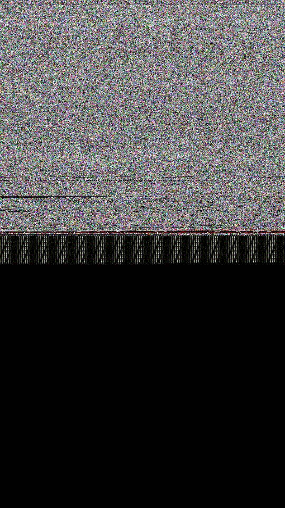

# W18 Halma batch report — CORRECTED (S212/WP10§6, #587)

This report supersedes the eleven per-run auto-reports whose defects are listed below.

## Batch facts (all 11 runs: halma_w18_r1 .. halma_w18_r11)

| fact | value |
|---|---|
| APK | `upload/canonical_apks/app.halma*.apk` (package `app.halma`, Activity `app.halma.AndroidLauncher`) |
| Screenshots | 1 retained full PNG `runs/halma_w18_r1/screenshot.png` (2863835 bytes, 1080x1920, sha256 15130c72ce569ae8aa457ffe9ce9d3e0cd068330d7812fccc0147bb0d4b44868) |
| Other 10 runs | screenshots deleted; per-run SHA-256 + run identity preserved in `halma_w18_batch_summary.json` and `halma_w18_retention_manifest.json` |
| Census | F-NEW-200 stub-census: 924 IMPLEMENTED, 63 STUBBED, 0 MISSING, 0 ERROR — success claim is stub-bounded |
| Exceptions | F-016: 1 uncaught in-flight exception past all app frames (per run) — NOT a clean complete-app pass |
| Trace verdict | RENDER_OK with result NO_APP_OPS; `frame_analysis.verdict` says REAL_APP_CONTENT — CONTRADICTION recorded, ownership classifier unreconciled |
| app_draw_ops / ViewTree | 0 / depth_max=0 — no real draw walk content |
| Honest verdict | NOT a gameplay/UI pass. Proves: APK load, manifest+DEX parse, lifecycle dispatch, surface creation, repeatable first-frame boundary |

## Inter-run pixel analysis

Every run differs from r1 by exactly 10,572 px (0.51%) and every differing pixel is the single shade pair `(70,127,0) -> (47,127,0)` — nondeterministic shading of one UI element. No run contains a distinct error, first divergence, output or state transition, so 10 full-size PNGs add no independent visual finding.

## Defects corrected vs the old per-run reports

1. wrong APK store path (r4 pointed at `store_halma_w18_r1`) — batch-level APK identity now stated once
2. wrong screenshot size (claimed 7.91 MB; tracked blob is 2,863,792–2,865,516 bytes) — corrected
3. duplicated `Output Frame` section in every report — single section here
4. headline `SUCCESS ✅` without F-016/stub caveats — honest verdict above
5. `app_owned_pixels=975,949` presented as app content while `app_draw_ops=0` — contradiction recorded instead of repeated

## Retained screenshot

*The image above is the canonical pixel evidence for all 11 runs (r2..r11 differ only in the documented shade pair). The preview `halma_w18_preview.jpg` is a DERIVATIVE / NOT PIXEL-EXACT for human browsing only.*
