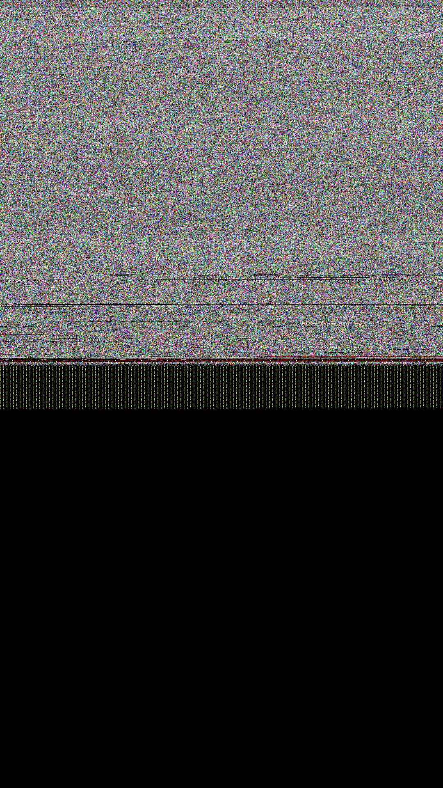

# W18 Halma run halma_w18_r1 — CORRECTED (S212/WP10§6)

- APK package: `app.halma` (canonical `upload/canonical_apks/app.halma*.apk`)
- screenshot sha256: `15130c72ce569ae8aa457ffe9ce9d3e0cd068330d7812fccc0147bb0d4b44868` (2863835 bytes, 1080x1920)
- disposition: KEEP (representative full PNG)
- F-016: 1 uncaught in-flight exception(s); F-NEW-200 census: 924 IMPLEMENTED / 63 STUBBED
- trace verdict: NO_APP_OPS (RENDER_OK); summary verdict REAL_APP_CONTENT is an unreconciled classifier contradiction — NOT evidence of app UI
- honest status: first-frame boundary evidence only; NOT Halma gameplay/UI

Full batch analysis: `../../halma_w18_BATCH_REPORT.md`; per-run SHAs: `../../halma_w18_batch_summary.json`.

