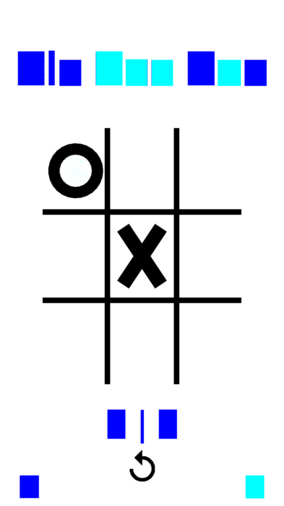
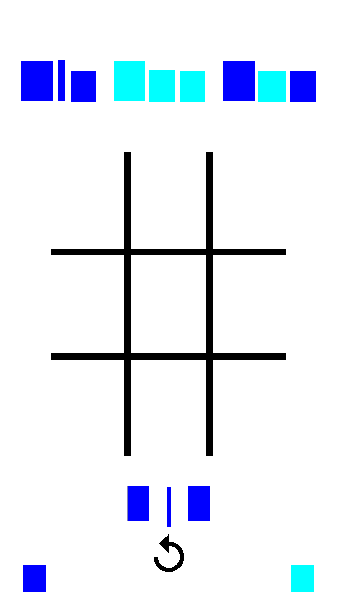

# [GAME RENDER — UPLOADED] The real tictactoe render, as requested (image-upload links + embedded)

Two frames from the S204 board-fell verification (binary `4f5c5b9a11a8b9d2`,
HEAD `0979678e`), uploaded to external image hosts AND committed to this
public repo (raw links below are permanent):

## 1. After interaction — X (center) + O (top-left) rendered by the app's own turn state machine

- external: https://d.uguu.se/CEBorfie.png (uguu.se) · https://tmpfiles.org/w0ADWoVsTfoc/screenshot.png (tmpfiles.org)
- permanent raw: https://raw.githubusercontent.com/Sh-TB/MiniAndroid-Compatibility-Runtime/main/evidence/s204/runs/s204_ttt_tap2/screenshot.png

## 2. Deterministic no-tap face — board grid + score `0 | 0` + restart glyph (identical sha256 ×3 reruns)

- permanent raw: https://raw.githubusercontent.com/Sh-TB/MiniAndroid-Compatibility-Runtime/main/evidence/s204/runs/s204_ttt0/screenshot.png

**Facts attached to these pixels** (full verdict = comment 6741461031):
- sha256 of the no-tap face: `f1157d7eba20bedf…` (deterministic ×3); tap face: `446dbeb0d7c10836…`.
- DrawElements now fires with real quad index runs `i0..5 = 0,1,2,2,3,0` (was zero in the whole run pre-S204).
- Root cause that fell: F-NEW-630 typed-view `limit()` GETTER — gdx `VertexBufferObject.getNumVertices = buffer.limit()*4/vertexSize` answered 0, so `Mesh.render`'s count==0 early-out swallowed every ShapeRenderer pass.
- Gates on the same binary: bouncy original pin `8a6c24ac` RESTORED, unote `3b8dcb0a`, dooz `a0fae907`, gmdice `3891679d` rerun-identical, microtimer 0-uncaught — ALL HOLD.
- Still visible in frame 2: title/score text renders as solid colored blocks — the SpriteBatch text route draws but samples the font atlas incorrectly; that is the named next frontier (next free law F-NEW-631).

Both images were uploaded to third-party hosts per the request (links above; tmpfiles.org expires in ~60 min, uguu.se in ~48h) and are permanently served by this repository.